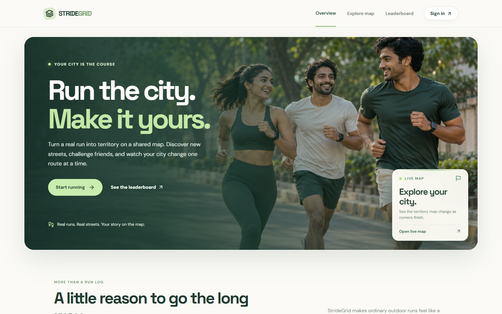
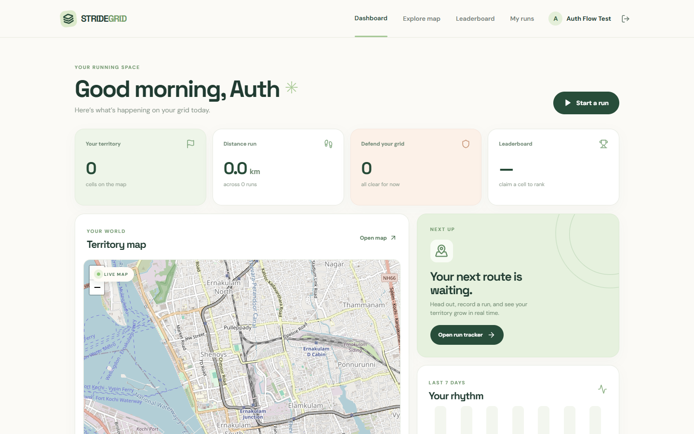
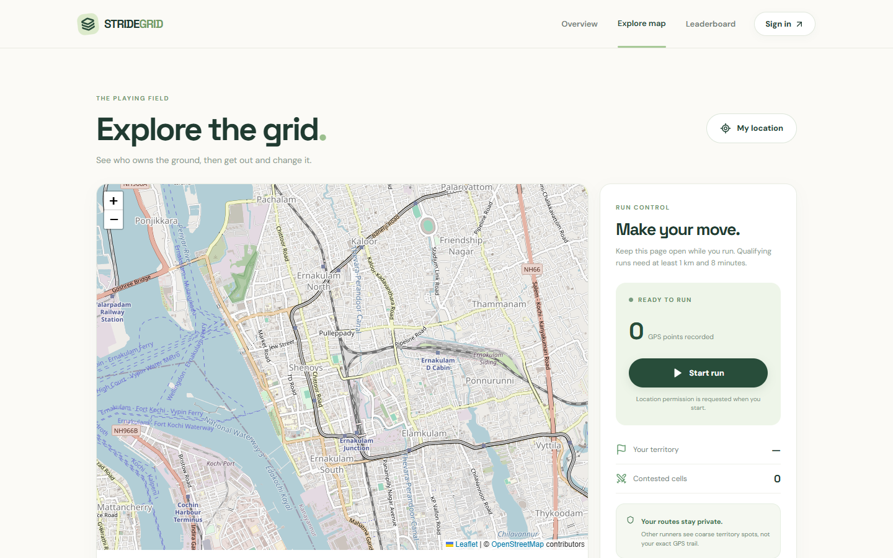
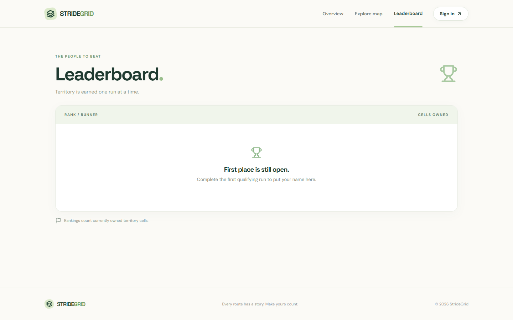
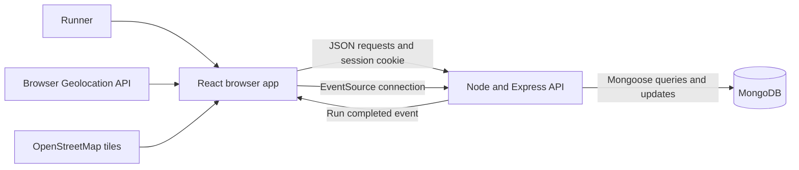
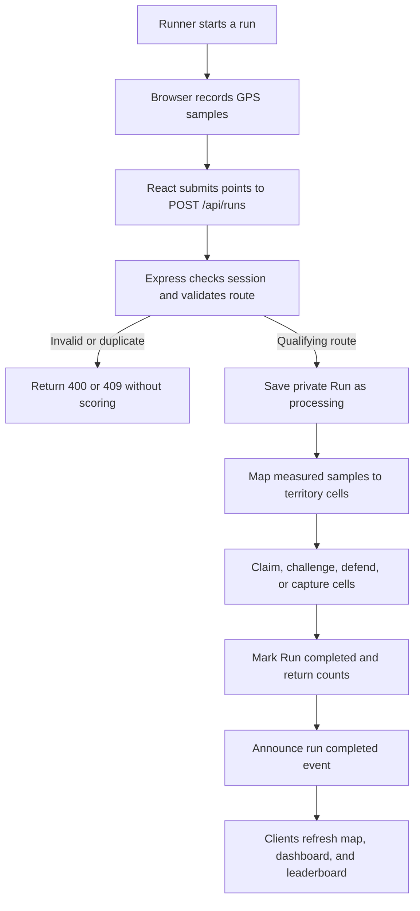

# StrideGrid

**MERN Stack Skill Enhancement Capstone Project** by Anugrah K S, Sahrdaya College of Engineering and Technology, Kodakara.

StrideGrid is a MERN capstone project that turns outdoor runs into a territory game. Runners record a GPS route in a mobile browser, claim unowned map cells, challenge another runner's cells, defend their own cells, and compare territory on a leaderboard.

The public landing page introduces the game through an animated feature section, a live map preview, and a clear start flow. Personal territory, distance, and defense statistics appear after sign-in on the dashboard.

**Current status:** The first playable version and signed-in dashboard are implemented. Local development can run without an external MongoDB service; production needs a MongoDB connection and a real outdoor GPS test. No hosted URL is available yet.

## Project links

| Item | Link or status |
| --- | --- |
| Hosted application | Not deployed yet |
| Public GitHub repository | [anugrahks19/StrideGrid](https://github.com/anugrahks19/StrideGrid) |
| Software Requirements Specification | [SRS Word document](reports/StrideGrid_Software_Requirements_Specification.docx) · [requirements draft](docs/SRS.md) |
| Project report | [Capstone report](reports/StrideGrid_Capstone_Project_Report.docx) |

## Screenshots

These images show the local interface with a new account and **no completed outdoor run**. The empty dashboard, run history, and leaderboard are honest empty states; gameplay screenshots should be captured after a verified run.

| Public landing page | Signed-in dashboard |
| --- | --- |
|  |  |

| Explore map and run controls | Leaderboard |
| --- | --- |
|  |  |

Additional views: [Create account](docs/screenshots/register.png) · [Sign in](docs/screenshots/login.png) · [My runs](docs/screenshots/runs.png).

## Features

- Public landing page, territory map, recent activity, and leaderboard.
- Complete registration, sign-in, session restoration, and sign-out flow; signed-in runners land on the dashboard.
- Personal dashboard with territory, contested cells, distance, recent runs, rank, and map.
- Foreground browser GPS tracker with live sample count, time, distance, and accuracy feedback.
- Server-side run validation, duplicate detection, and claim/challenge/defend/capture rules.
- Private run history and public game updates through server-sent events with a 30-second refresh fallback.

## Tech stack

| Layer | Technology | Use in StrideGrid |
| --- | --- | --- |
| Frontend | React 19, Vite 6, React Router | Pages, forms, dashboard, navigation, and production build |
| Map | Leaflet, React Leaflet, OpenStreetMap tiles | Territory map and live route display |
| Backend | Node.js, Express 4 | JSON API, route validation, scoring, authentication, and live events |
| Database | MongoDB, Mongoose 8 | Users, private runs, and territory cells |
| Location | Browser Geolocation API | Foreground GPS samples after the runner grants permission |
| Authentication | bcrypt, JWT, HttpOnly cookie | Password hashing and signed sessions |

The application logic and persistent data use the MERN stack. Leaflet renders the map; it is not another application backend.

## Architecture



The browser calls Express; it never connects to MongoDB directly. Express serves the built React app in production. The server has separate routes for authentication and game data, reusable GPS and territory logic, and three Mongoose models: `User` (account), `Run` (private route and outcomes), and `Territory` (cell owner and optional challenger). Public map and leaderboard endpoints expose summaries; `/api/runs` is limited to the signed-in runner.

## Data flow

**Account flow:** The registration or sign-in form sends credentials to `/api/auth`. Express validates the request, looks up or creates a `User`, and sets a signed JWT in an HttpOnly cookie. The client calls `/api/auth/me` on reload to restore the session. Protected pages and run endpoints require that cookie.

**Run and territory flow:**



The server filters unreliable or implausible samples, checks the route hash for an exact repeat, and scores only measured locations. Each accepted cell update is stored in MongoDB; the completed run stores distance, duration, and outcome counts. Raw GPS samples stay in the private run record and are not sent through public territory, activity, or leaderboard endpoints. Open clients receive a server-sent event and fetch fresh public data; a 30-second poll provides a fallback.

## MVP rules

1. A run needs at least five samples, eight minutes, and one kilometer. Samples with poor accuracy are excluded; implausible GPS jumps are rejected or filtered.
2. Accepted GPS samples are assigned to 150-meter projected grid cells. A cell counts after at least 35 meters of measured travel is attributed to its samples. The server does not fill unsampled straight-line gaps, which could cross water. A run can affect at most 30 cells.
3. The first runner to visit an unowned cell claims it.
4. Visiting a rival's cell starts a seven-day challenge. A second qualifying run through that cell by the same challenger captures it.
5. The owner can defend a contested cell by running through it during the challenge period.
6. The leaderboard ranks runners by currently owned cells.

The tracker waits for GPS readings accurate to 50 meters or better and avoids drawing lines through long gaps. These checks reduce GPS mistakes and basic replay attempts; they do not prove that a person physically ran or verify that every point is on land. Exact routes are private to the runner. Other users see compact territory markers snapped to 25-meter positions, cell bounds, and public names.

## Run locally

Requirements: Node.js and npm. MongoDB is optional for local development: without `MONGODB_URI`, the server starts a local MongoDB instance and stores its data in the ignored `.local-data/` folder. The first run downloads a MongoDB binary, which can take a while.

```powershell
npm ci
npm run dev
```

Open `http://localhost:5173`. Vite proxies `/api` to Express on port 5000. To use your own MongoDB locally, copy the example environment files, set `MONGODB_URI` in `server/.env`, and replace `JWT_SECRET` with a random secret of at least 24 characters.

```powershell
Copy-Item server/.env.example server/.env
Copy-Item client/.env.example client/.env
```

The client `.env` file is optional for local development: `/api` is already the default. If you copy the server example, replace its example `JWT_SECRET` before using a real database. Real `.env` files and `.local-data/` are ignored by Git.

| Variable | Where | Purpose |
| --- | --- | --- |
| `PORT` | Server | Express port, default `5000` |
| `MONGODB_URI` | Server | MongoDB URI; required in production, optional with the local development database |
| `JWT_SECRET` | Server | Session signing secret of at least 24 characters; required in production |
| `NODE_ENV` | Server | Set to `production` to serve the built client and use a Secure session cookie |
| `CLIENT_ORIGIN` | Server | Allowed frontend origin if the client and API are on separate origins |
| `VITE_API_URL` | Client | API base URL; defaults to `/api` |
| `VITE_TILE_URL` | Client | Map tile URL |

Never put secrets in `VITE_` variables: Vite embeds them in the browser build.

To build for production:

```powershell
npm run build
npm start
```

In production Express serves the built React app from the same origin. Serve it over HTTPS: browsers require a secure context and user permission for Geolocation. Test a full run on the deployed URL; localhost UI testing alone does not verify GPS behavior.

### Suggested hosting setup

Use **one Render Node web service for the client and API**, plus **MongoDB Atlas for the database**. This matches the current same-origin cookie and live-event design. Vercel alone is not a drop-in target for this app: its Express support runs as a function and does not use this project's `express.static()` setup, while the event stream expects a long-lived server connection. See the [Render Express guide](https://render.com/docs/deploy-node-express-app), [Vercel Express documentation](https://vercel.com/docs/frameworks/backend/express), and [Atlas connection guide](https://www.mongodb.com/docs/atlas/connect-to-database-deployment/).

1. Create an Atlas cluster and database user. Copy the application connection string and configure Atlas network access for the web service; keep the URI private. Atlas documents its [IP access list](https://www.mongodb.com/docs/atlas/security/ip-access-list/).
2. Push this repository to GitHub. In Render, create a **Web Service** connected to that repository, with the repository root as the working directory.
3. Set **Build Command** to `npm ci --include=dev && npm run build` and **Start Command** to `npm start`. Vite is a development dependency needed during the build even when `NODE_ENV=production` is configured.
4. Set Render environment variables: `NODE_ENV=production`, `MONGODB_URI` to the Atlas connection string, and `JWT_SECRET` to a new random secret of at least 24 characters. Render supplies `PORT`; the server already reads it. Keep `VITE_API_URL` at its `/api` default and leave `CLIENT_ORIGIN` unset for this same-origin setup.
5. Open the Render HTTPS URL, check `/api/health`, then test registration, sign in, dashboard refresh, the map, and a genuine outdoor qualifying run on a phone. Add that URL to the project links above and to the capstone report.

Render's web service provides an HTTPS `onrender.com` URL and can redeploy from GitHub. Hosting the frontend separately would require code changes for the hard-coded `/api/events` connection and a review of cross-origin cookie behavior; the instructions above avoid those changes. See [Render web services](https://render.com/docs/web-services).

## API

| Method | Path | Purpose | Auth |
| --- | --- | --- | --- |
| POST | `/api/auth/register` | Create runner account | No |
| POST | `/api/auth/login` | Start session | No |
| POST | `/api/auth/logout` | End session | No |
| GET | `/api/auth/me` | Current runner | Yes |
| GET | `/api/territories` | Public territory cells | No |
| GET | `/api/leaderboard` | Top ten by cells | No |
| GET | `/api/activity` | Recent completed runs without private routes | No |
| GET | `/api/events` | Live completed-run event stream | No |
| GET | `/api/runs` | Current runner's completed runs | Yes |
| POST | `/api/runs` | Submit, validate, and score a run | Yes |
| GET | `/api/health` | API health | No |

Successful run submission returns distance, duration, and counts of claimed, contested, captured, and defended cells. Validation errors return `400`; missing auth returns `401`; a duplicate route returns `409`. After sign-in, runners land on `/dashboard`. A completed run announces an event so open dashboards can refresh; a 30-second poll provides a fallback.

`POST /api/runs` accepts a JSON object with a `points` array. Each point has `lat`, `lng`, `accuracy` (meters), and `timestamp` (Unix milliseconds). A real request needs a qualifying sequence, not a single point. API errors use `{ "error": "message" }`; routes marked as authenticated use the session cookie.

## Project structure

```text
client/src/             React pages, dashboard, map, and API client
client/public/images/    Landing and account imagery
server/src/models/      Mongoose schemas
server/src/routes/      Authentication and game endpoints
server/src/lib/         GPS validation, cell geometry, game rules
docs/SRS.md             Requirements and acceptance criteria
docs/screenshots/        Major client-side views for review
reports/                Capstone report and SRS Word documents
```

## Test and review

```powershell
npm test
npm run build
```

Unit tests cover map cell conversion, route coverage, plausible and implausible GPS samples, and claim/challenge/defend/capture transitions. Before submission, test registration, login, the dashboard, a live outdoor run, route rejection, live leaderboard updates, mobile layout, and deep-link refresh against a deployed MongoDB-backed version. Use two runner accounts for the challenge/defense demonstration.

## Privacy and limitations

- The application stores raw GPS samples to audit a runner's own run. The public API never returns those points.
- Territory markers use coarse locations derived from accepted samples. They do not reveal the complete GPS trail, but they still indicate where a runner has been; obtain consent before using this app for real-world tracking.
- GPS location can be spoofed; this is an academic MVP, not a prize-bearing competition.
- The browser must stay open during a run. Reliable background tracking would require a separate native app.
- A run updates several territory documents. Those updates are not yet one atomic transaction, so an interrupted write may leave a partial result. This is the main correctness improvement before a large launch.
- The public territory endpoint currently caps responses at 5,000 cells. Area-based querying is needed for larger use.
- `tile.openstreetmap.org` is configured for small-scale interactive use with visible attribution. Replace it with a suitable tile provider before significant traffic; the tile URL can be changed with `VITE_TILE_URL`. Follow the [OSM tile usage policy](https://operations.osmfoundation.org/policies/tiles/).

## Submission checklist

- [x] Prepare the SRS document for the course assignment
- [x] Create and share a public GitHub repository
- [ ] Deploy the built app and MongoDB-backed API over HTTPS
- [ ] Verify core flows on the hosted URL
- [ ] Add hosted and repository URLs to this README and the report
- [x] Capture the current overview, registration, sign-in, dashboard, map, leaderboard, and history views
- [ ] Capture an active run, result, populated gameplay, and mobile views after real testing
- [x] Prepare the project report using the course's required format
- [ ] Check repository history and screenshots for secrets or personal location data
